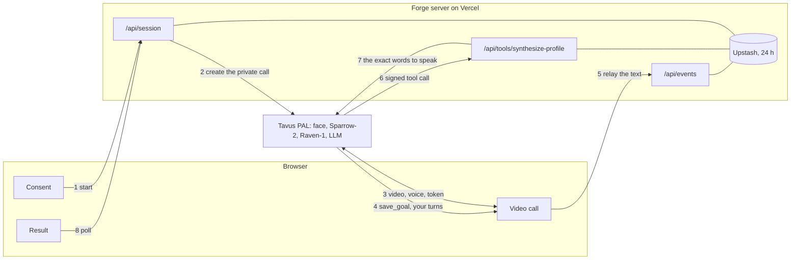

# Forge on Tavus

Forge is the friend who knows way too much about personality types, and it lives on a Tavus video call. You name a goal or two, tell a few real stories, and Forge tells you how you work across four frameworks, what that means for each goal, and one small move to try this week. It runs on Tavus CVI: a Phoenix face, Sparrow-2 turn-taking, Raven-1 perception, two tools, and a small Next.js server that checks everything the model says before Tavus says it out loud.

Watch it: the Loom link goes here before Monday.

## Why I built this

Forge is my own project. Before this take-home it was a voice agent, and the way I described it to friends was "I created my own voice agent that talks to you like a therapist and guesses your MBTI and enneagram". The typing method and the corpus behind it are mine, so this was the one idea where I'd be building the product, not a demo of a product. Forge's rule from day one: action is the product, not the label. Every type quiz stops at the label.

Tavus gives it two things I couldn't build in a weekend. A face that reacts while you talk, and Raven, which reads what the words leave out. When your voice speeds up on a story, Forge can stay there one more question. That's the moment I'd point at in a demo.

It also fixed the thing I never liked about the voice version. It's extremely hard to get AI to be "human" across all industries, and the version that works here isn't a therapist. Forge is a friend over coffee with strong opinions about typology, and it refuses to guess when your stories don't agree.

## What happens in one call

1. You tick one box (18 or older, you know Forge is an AI, you're okay with Tavus reading your expressions and tone), add a first name if you like, and say hi. The mic and camera are checked before anything is paid for: no mic, no call; no camera, voice only.
2. The server checks the passcode, checks that Tavus lists no live call, and creates a private room with your name, the call length and your country's crisis line in its context. Billing starts here.
3. Forge says it's an AI, then asks what you're working toward. Each goal you name pops onto the screen while Forge keeps talking.
4. You tell a few stories: a choice that changed things, what recharges you, what drains you. Sparrow-2 lets you finish, Raven notices pauses and energy, and the browser forwards the text of your turns to Forge's server. At 2:45 the browser nudges Forge to wrap up.
5. Forge says "Give me a sec, I'm putting it all together." The model posts its picks to my server, signed. The server checks every quote against your own words, writes the reveal, and Tavus speaks it word for word. Your goal cards appear, Forge walks the rundown in three short turns, and the call ends by about five minutes. If no reading lands by 4:00, the screen says "No reading this time" and keeps your goals. "Delete my data" wipes Forge's copy and hard-deletes the Tavus conversation.

## How it works



Six decisions, and the trade-off each one makes.

**1. The model picks, the code quotes.** The trick is simple: the model picks from fixed lists and copies your exact words, and the code checks every quote before Tavus says a word. The lists are one of 16 TRC rows (or none), pattern ids, confidence words, and up to six pieces of evidence of 3 to 12 of your own words. The server looks for each piece inside one of your stored turns, after tidying both sides the same way (lower case, no punctuation, "I'm" equals "I am", "5" equals "five"), and drops anything you never said. It refuses a type when fewer than three different answers agree, reads the Jungian and Socionics codes off the TRC row so they can never contradict it, lints every model-written line (no codes, no dashes, no quotation marks, no therapy-speak, no clinical words) and swaps a failed line for a template built from the row. The trade-off: the model can't be eloquent about your type. It can only be right or quiet. I'll take that, because one invented quote on a result screen ends the trust for good. `tests/synthesize.test.ts` is the proof: a phrase you never said never reaches the screen or the reveal, not even a near miss or two answers stitched together.

**2. The reveal goes server to server, signed, and is spoken word for word.** `synthesize_profile` is delivered over HTTPS with an HMAC on the exact bytes, like a wax seal my server checks before it believes anything. The server answers plain text and Tavus reads it out exactly as written. Every failure past the signature check still answers 200 with a safe line ("I couldn't put that together cleanly, so I'd rather not guess"), because a status Tavus would retry or improvise around is worse than an honest sentence. Once the reading is in, the browser hands Forge the checked rundown as context with every code spelled out ("Jungian: I, N, T, J"), since text-to-speech reads LIE or SEE as words. The trade-off: a 20-second window, a fixed filler line while it runs, and a few hundred lines of server code instead of letting the model talk. The alternative, an app message, is dropped silently above 4 KB, and this is the one message in the call that can't vanish.

**3. Two tools, with the evidence inside the one big call.** `save_goal` fires once or twice, early, as an app message with a filler so Forge keeps talking while it saves. The browser forwards your turns. Everything else rides inside `synthesize_profile`. I had a third tool for live "Noted" notes after every story and cut it: whether the model's own words also get spoken next to a filler-style tool call is undocumented, and I didn't want that unknown five times a call. The trade-off is a quieter screen during the stories.

**4. A private room with server-set limits.** `require_auth` with a meeting token the browser passes to join explicitly, two participants, a 300-second cap, a 120-second join window, 10 seconds after you leave, one live call at a time (Tavus is the source of truth, not my store, so a lost End never blocks the next call), a passcode, and End on every path: the button, leaving the room, closing the tab, and Forge's own `end_call`. The trade-off: one person at a time, and turning the token off is a redeploy. For a demo on a free plan that's the right trade.

**5. Raven paces but never types, with consent and a one-switch EU mode.** Three audio and four visual questions about pauses, pace, energy and expressions. The prompt uses them to wait or to stay, and once a call Forge may name one with your own topic ("You lit up talking about the workshop. Want to stay there a sec?"). The type comes from the stories only; the corpus is explicit that tone and intensity don't type anyone. The consent screen says all of this in plain words, and `FORGE_EU_POLICY=always` adds `policy: eu` to every call so emotion recognition resolves the EU way. The trade-off: EU mode is one global switch, not per visitor. Enough to show the path, not enough for a product.

**6. Rules in the prompt, no knowledge base, only the CC BY text shipped.** The whole method (the patterns, the TRC table, the hunch bank, the move kinds) is about 2,900 tokens of system prompt, and the corpus file in the repo holds only the 16 TRC rows, short glosses and label words. The trade-off: no retrieval, so no long definitions on demand, and two of my corpora stay out of the repo on purpose. In return the rules apply on every turn, nothing pulls type talk into the stories, and the prompt plus both tools sits about 150 tokens under Tavus's 5,000-token guidance.

The PAL, in one breath: `pipeline_mode: full` (Raven and speech recognition need it), a stock Phoenix-4.5 face, `languages: en`, disclosure always on, `sparrow-2` set explicitly because many stock PALs still pin the deprecated sparrow-1, medium patience and interruptibility, patient idle engagement, `raven-1` with emotion recognition on auto, one guardrail (`crisis_self_harm`), and Tavus defaults for everything else. The LLM is whichever of `tavus-gpt-5.6-terra` and `tavus-gemma-4` filled the schema cleanly across two live runs; `config/pal.json` holds the one in use.

What's in the repo:

```text
config/    the Tavus setup as code: the system prompt, pal.json, tools.json, guardrail.json, ids.json
scripts/   setup-tavus.ts (creates everything once, safe to re-run) and build-corpus.ts
lib/       the Tavus client, the store (Upstash or memory), the pure synthesize function, safety
app/       page.tsx, the three screens, the hooks, the API routes, and the CVI block from Tavus's CLI
tests/     synthesize.test.ts and synthesize-route.test.ts, built on one fixture called Sam
```

The CVI block is Tavus's own code with three patches: the meeting token is passed to join, the face filter accepts either participant id, and chat and screen share are gone (Raven can see a shared screen).

## What one session costs

Tavus bills from create to end, with a 30-second minimum and rounding to 6 seconds. Prices are the per-minute rates on tavus.io/pricing as I read them on 2026-10-16.

- The default five-minute arc (`FORGE_ARC=5`): a full call is 300 seconds. That's $1.75 on Builder ($0.35 a minute), $1.55 on Growth ($0.31) and $1.30 on Business ($0.26). On the Free plan (20 minutes, a 5-minute cap per call) it comes out of the included minutes. That's the plan I built on, which is why 5 is the default.
- The seven-minute arc (`FORGE_ARC=7`): about 7.5 minutes with the wrap-up, so about $2.60, $2.30 and $1.95. Tavus caps `max_call_duration` to the plan's maximum without saying so, so 7 needs Starter or higher; on Free the call simply ends at 5:00.
- A no-show: the 120-second join window at most, about $0.70 on Builder.
- Forge's side: Vercel and the Upstash free tier (500K commands a month; one call uses a few hundred). Pennies.
- At 50,000 sessions a month on the five-minute arc, that's 250,000 minutes, about $65,000 at the Business rate, so an Enterprise conversation.

## What I cut, and why

The brief said three to four hours. My honest estimate going in was seven to nine for a version that would survive a live demo, so I cut early and wrote the rest down. I cut memory, webhooks and live notes on purpose; the call had to work first, and it did in about nine hours.

- Memory (an opt-in tag, pinned goals and reading, "Forget me" as one delete): designed. Proving it costs a second live call and changes the consent copy.
- Live "Noted" notes and the stage dots: per-turn tool calls were the biggest live risk, and the evidence now rides inside the one signed call.
- Webhooks and a callback route: after the call, one verbose GET gives the transcript, the shutdown reason and Raven's summary. Webhooks aren't signed in the docs anyway.
- A staging PAL: config in git plus a freeze 24 hours before the demo does the job for one person. A customer gets staging.
- Per-visitor EU detection: one env switch instead. The country header picks the crisis line only.
- A knowledge base: one upload away once the call is stable.
- Timing profiles, a presenter drawer, simulate and kill scripts: one arc switch, a plain text log behind `?presenter=1`, one Vitest test that signs the fixture, and one curl.
- Stretch: a second reading after the settling question, server-sent events instead of the 3-second poll, and "where you lit up" on the result screen.

## What surprised me

- A tool call over 4 KB on the app message is dropped with no error. That one line in the docs is why the reading goes server to server.
- The conversation block from the CLI can't join a private room: it never passes the meeting token. Two lines to patch, an hour to find.
- Tavus lowers the call cap to your plan's maximum without saying so. On the Free plan my seven-minute arc would have ended at 5:00, mid-reveal, which is why five is the default.
- The browser can't see a tool that's delivered over the API, so "Putting it together" on screen comes from spotting the filler line in Forge's speech.

The full log, ten items in three trends with one fix per trend, is in [FDE-NOTES.md](FDE-NOTES.md).

## Limits

- For getting to know yourself, not a test. TRC is a cognitive processing model, not a validated psychometric test, and Forge is not clinical: no diagnoses, no treatment, no decisions about other people, never for hiring.
- It refuses a lot, on purpose. Forge's full method was designed for a 15 to 30 minute conversation. In five minutes, most unscripted calls end with "I won't guess a type yet" and the one question that would settle it. That's the feature.
- Safety is a floor, not a guarantee. The prompt stops the type stuff on a crisis and gives the line for your country (Samaritans in the UK, call or text 988 in the US, findahelpline.com anywhere else), the same line that's on your screen. The Tavus guardrail is a backup: it shows a card and tells the server to refuse any reading. Tavus says guardrails are not guaranteed, so the prompt and the server carry it.
- English only, tested on desktop Chrome, one call at a time, age self-declared.
- Data: your goals, the text of your turns, the reading and a debug record live 24 hours at Forge. Tavus keeps its transcript until "Delete my data". Nothing is recorded. Tavus's default retention isn't in the docs, so I'd confirm it before putting real clients on this.

## Running it

You need Node 24, a Tavus API key, a public https URL Tavus can call, and a free Upstash Redis for production.

1. `npm install`. Every version is pinned exactly, the CVI block's three dependencies included.
2. `cp .env.example .env.local` and fill it in:
   - `TAVUS_API_KEY`: server only, sent to tavusapi.com and nowhere else.
   - `TOOL_HMAC_SECRET`: `openssl rand -hex 32`. The seal on the `synthesize_profile` call.
   - `PUBLIC_BASE_URL`: the production origin, because Tavus has to reach `/api/tools/synthesize-profile` and Vercel protects every non-production URL.
   - `DEMO_PASSCODE`: what a visitor types before a call is created.
   - `FORGE_ARC`: 5 (the default) or 7.
   - `FORGE_REQUIRE_AUTH`, `FORGE_EU_POLICY`, `FORGE_TEST_MODE`: the three switches described above.
   - `KV_REST_API_URL` and `KV_REST_API_TOKEN` (the Vercel Marketplace names), or the `UPSTASH_REDIS_REST_` pair. Locally with neither, a memory store runs. On Vercel with neither, the store-backed routes answer 503 instead of quietly splitting Tavus's request and the browser's poll across two servers.
   - `CORPUS_DIR` only if you rebuild `lib/corpus/forge-corpus.json`; the built file ships in the repo.
3. `config/ids.json` holds the ids of my PAL, tools and guardrail on my Tavus account, and they only work with my key. To run on yours, delete `config/ids.json` and run `npm run setup:tavus`. It creates the guardrail, the two tools (with your URL and secret filled in) and the PAL from `config/`, attaches the tools, reads everything back and writes each id the moment it exists. It's safe to re-run after a partial failure, it refuses once `ids.json` holds a PAL, and later changes are hand-run PATCHes.
4. `npm run typecheck`, `npm test` and `npm run build`. The tests cost zero Tavus minutes: they sign the Sam fixture and call the route handler directly.
5. Deploy to Vercel production, connect Upstash from the Marketplace, set the env, redeploy. Open the URL, type the passcode, say hi.

Two checks that cost no minutes:

- `FORGE_TEST_MODE=true` creates the call as already ended, so no face joins. With `?presenter=1` you can replay the fixture events through the real handler and watch the chips, the log and the store fill.
- The production curl signs the fixture with your secret and posts the same bytes (`--data-binary` keeps them exactly as signed):

  ```bash
  set -a; . ./.env.local; set +a
  sig=$(openssl dgst -sha256 -hmac "$TOOL_HMAC_SECRET" < tests/fixtures/envelope.json | awk '{print $NF}')
  curl -s -i -X POST "$PUBLIC_BASE_URL/api/tools/synthesize-profile" -H "Content-Type: application/json" -H "X-Tavus-Signature: $sig" --data-binary @tests/fixtures/envelope.json
  ```

  Expect 200, `text/plain`, `x-forge-store: upstash` and the "I don't have enough of your stories yet" line, since that conversation has no stored turns. A wrong signature gets 401.

A local `npm run dev` gives you the consent screen, the call and the goal chips. The reveal is posted to whatever `PUBLIC_BASE_URL` the tool was created with, so the full arc runs on the deployed URL. `?presenter=1` adds a plain log under the screens: every event, timings from Forge's first word, the time check, the watchdog, and the debug record (evidence sent and matched, which refusal fired on what count, which lines were replaced).

## Credit

The 16 TRC rows, the function taglines and the stack definitions come from Temporal Reference Cognition (TRC) by Gourav Kumar Mallick (Parul University), licensed under [CC BY 4.0](https://creativecommons.org/licenses/by/4.0/). The plain-words glosses and the template wording are Forge's own, not part of TRC. The Jungian, Socionics and Enneagram material in this repo is label words only.
