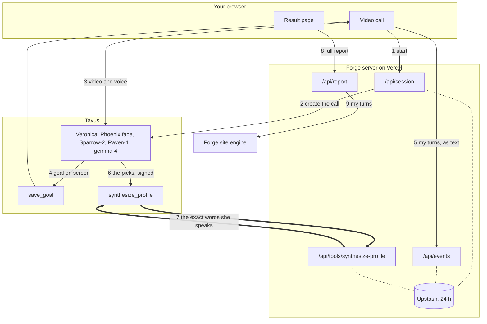

# Forge on Tavus

Get on a video call with Veronica, a friend who knows way too much about personality types. Tell her a few real stories and she works out how you think, across seven typology systems, with one move to try this week. Live at [forge-on-tavus.vercel.app](https://forge-on-tavus.vercel.app).

## Why

Half the internet is trying to figure itself out through MBTI, the Enneagram and Socionics. Most people take a quiz, get a label, and argue about it with strangers for weeks, because a quiz only knows what you clicked. Getting typed properly means someone listening to your stories for an hour, and the people who do that well charge like a therapist.

Forge is my own typing method. Before this take-home it was a voice agent. Tavus gives it the two things I couldn't build in a weekend: a face that reacts while you talk, and Raven, which notices when you light up or go quiet. People tell a face things they'd never type into a quiz.

## What happens on a call

1. Add a first name if you like, tick the box, say hi. The server creates a private Tavus room with your name and your country's crisis line in its context.
2. Veronica says she's an AI, asks about your day, and eases into what you're working toward. Each goal pops onto the screen.
3. You tell stories. She probes each one until she can tell how you take things in and how you decide. If an answer is "a bit of both", she asks narrower yes-or-no questions until one lands, and never repeats herself.
4. She calls `synthesize_profile`. My server checks every quote against what you actually said, composes the reading, and Tavus speaks it word for word. She sums it up in one turn: your type by its letters, one move, bye.
5. Your full report is already building, since it starts mid-call. It opens inside the result page, with the whole seven-system version one click away on the Forge site.

## How it works



The thick arrows are the reveal: the model's picks reach my server signed, and the words Veronica speaks come back.

## Decisions

- **The model picks, the code quotes.** Veronica chooses from fixed lists and copies 3 to 12 of your own words as evidence. The server keeps only quotes it finds in your turns, rates its confidence by how many answers back each pick, and refuses a type when fewer than two do. She can't get poetic about you, and `tests/synthesize.test.ts` proves a phrase you never said never reaches the screen.
- **The reveal goes server to server.** `synthesize_profile` is an HTTPS tool call with an HMAC on the exact bytes. App messages drop silently over 4 KB; the reading is bigger than that.
- **Tavus Objectives run the call.** Small talk, the goal, one step per type question, the reveal. My first open call wrapped up at seven minutes because a passing line sounded like a goodbye, and my second looped on one question eleven times. Objectives plus a yes-or-no ladder fixed both.
- **Raven sets the mood, never the type.** Seven awareness questions (a laugh, a flat voice, a look of discomfort, someone walking past) feed "when X, deliver Y" lines in her script. Emotion recognition is pinned to `full`; on `auto` Tavus passes her nothing from your face or voice.
- **The full report agrees with her.** The Forge site's engine reads the type fresh and can disagree (it read one call as ENTJ while she said ESTP), so the server pins the Jungian, Socionics and Enneagram cards to her reading and fills them with your goals and words. If the engine fails, you get a report built from the call alone.
- **Rules in the prompt, no knowledge base.** About 3,500 tokens of system prompt, inside Tavus's 5,000-token guidance, plus a pronunciation dictionary so "SEE" and "LIE" are read as letters.

Veronica plays an ENFJ 2w3 on gemma-4, Tavus's most natural model, with a Pro face that shows emotion on its own. Her speech habits come from two Emma Chamberlain podcast transcripts: a quick "wait" to open, the odd "like", a restarted sentence, very little slang. She has web search for the one-line lookup when you mention something she'd be clueless about, and a crisis guardrail as a backup to the prompt.

## Cost

Tavus bills from create to end. A full 30-minute call is about $9 on the Growth plan; the five-minute speed round (`FORGE_ARC=5`) is under $2 on any plan. Tavus caps `max_call_duration` to the plan's maximum without saying so, which is why the speed round exists.

## Limits

- Not clinical: no diagnoses, no decisions about other people, never for hiring. On a crisis she drops the type talk and gives the line for your country.
- English only, one call at a time, desktop Chrome. Your goals, turns and reading live 24 hours at Forge; the full report lives only in its link.

## Running it

You need Node 24, a Tavus API key, a public https URL and a free Upstash Redis.

1. `npm install`, then `cp .env.example .env.local` and fill it in. `PUBLIC_BASE_URL` is the production origin, since Tavus has to reach `/api/tools/synthesize-profile`.
2. `npm run typecheck`, `npm test`, `npm run build`. The tests cost zero Tavus minutes.
3. Deploy to Vercel, connect Upstash, set the env. Until setup has run, the say-hi button answers "not configured".
4. Delete `config/ids.json` (mine only works with my key) and run `npm run setup:tavus`. It creates the guardrail, the two tools, the objectives, the pronunciation dictionary and the PAL from `config/`, and writes each id as it goes. Redeploy and say hi.

One check that costs no minutes:

```bash
set -a; . ./.env.local; set +a
sig=$(openssl dgst -sha256 -hmac "$TOOL_HMAC_SECRET" < tests/fixtures/envelope.json | awk '{print $NF}')
curl -s -i -X POST "$PUBLIC_BASE_URL/api/tools/synthesize-profile" -H "Content-Type: application/json" -H "X-Tavus-Signature: $sig" --data-binary @tests/fixtures/envelope.json
```

Expect 200, `text/plain` and the "I don't have enough of your stories yet" line. A wrong signature gets 401.
