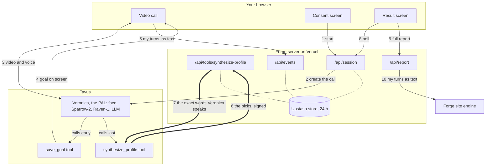

# Forge on Tavus

Forge is a website where you get on a Tavus video call with Veronica, the friend who knows way too much about personality types. You name a goal or two, tell her real stories for as long as it takes, and she tells you how you work across four frameworks, what that means for each goal, and one small move to try this week. A minute or two after you hang up, your full seven-system Forge report is ready too. Under it: Tavus CVI and a small Next.js server that checks everything the model says before Tavus says it out loud.

## Why I built this

Forge is my own project. Before this take-home it was a voice agent, and I described it to friends as "I created my own voice agent that talks to you like a therapist and guesses your MBTI and enneagram". The method and the corpus are mine, and every type quiz stops at the label, so Forge gives you a move instead.

Tavus adds two things I couldn't build in a weekend: a face that reacts while you talk, and Raven, which reads what the words leave out. When your voice speeds up on a story, Veronica can stay there one more question, and when it goes flat or tense she drops the jokes and slows down. That's the moment I'd point at in a demo. It's extremely hard to get AI to be "human" across all industries, and a friend over coffee with strong opinions about typology holds up. She refuses to guess when your stories don't agree.

## What happens in one call

1. On /homepage, add a first name if you like, tick one box (18 or older, and Veronica is an AI that reads your expressions and tone to pace the chat, the two notices Tavus asks for) and say hi. No mic, no call. No camera, voice only.
2. The server checks with Tavus that no call is live, then creates a private room with your name, the call length and your country's crisis line in its context. Billing starts here.
3. The address moves to /veronica-talks. Veronica says she's an AI, says nice to meet you and asks how your day was. A bit of small talk, then she eases over to what you're working toward. Each goal pops onto the screen while she keeps talking.
4. You tell your stories, and she probes each one until she can pin down how you take things in, how you decide, what drains you, the thought that keeps coming back, and a bit of your life. Sparrow-2 lets you finish, Raven tells her when you light up or go quiet, and the browser forwards the text of your turns to my server. When she has every piece she calls the reveal herself. The call is capped at 30 minutes, so at 27:00 the browser sends a time check: no new topics, one more quick question at most, then the reveal.
5. Veronica says "Give me a sec, I'm putting it all together." The reveal comes back from my server, Tavus speaks it word for word, your goal cards appear, and she sums it up in one short turn: your type by its Jungian letters (ESTP, never the TRC code AST) and the move she'd try first. No reading by 28:30 and the screen says "No reading this time" and keeps your goals. At 29:20 the browser tells her to say a quick bye and call `end_call`, since Tavus cuts the call at the cap without a warning. When the call ends the address moves to /report.
6. The moment the reading exists, still mid-call, the browser asks my server for the full report, so most of the build is done by the time you hang up. The server sends the text of your turns to the Forge site's own engine (its free-text extractor, then its unified scorer, a minute and a half to three minutes). That engine reads the type fresh and can disagree with Veronica (it read one call as ENTJ and then INTJ while she said ESTP), so the server pins the Jungian, Socionics and Enneagram cards to what she told you and fills them with your goals and your own words; the engine's other four systems pass through as it wrote them. The result page shows three breathing circles and "Building your report", then the report itself inside the page: headline, the three type codes, the summary, a few lines, your goal cards under it, and the full seven-system version one click away on Forge. If the extractor chokes on a long call the scorer runs on the raw words; if the scorer never answers you still get a report built from the call alone, and a second try asks the engine again.

`FORGE_ARC=5` swaps this for the five-minute speed round: Veronica says she's on a free trial, asks six or seven quick either-or questions, and gets the time check at 3:15 and the wrap-up at 4:25.

## How it works



The thick arrows are the reveal: the model's picks go to my server signed, and the exact words Veronica speaks come back.

Six decisions, each with its trade-off.

1. The model picks, the code quotes. It chooses from fixed lists and copies up to six pieces of evidence, 3 to 12 of your own words each. The server keeps only pieces it finds in your stored turns, says how sure it is by how many different answers back each pick, refuses a type only when fewer than two answers match, and templates any line that fails lint. Trade-off: the model can't get poetic about you, and `tests/synthesize.test.ts` proves a phrase you never said never reaches the screen.

2. The reveal goes server to server, signed, spoken word for word. `synthesize_profile` arrives with an HMAC on the exact bytes, and any failure past that check still answers 200 with a safe line, since a status Tavus would retry or improvise around is worse than an honest sentence. Trade-off: a 20-second window, a fixed filler line and a few hundred lines of server code, against an app message that's dropped silently above 4 KB.

3. Two tools, the evidence inside the one big call. `save_goal` fires early as an app message with a filler so Veronica keeps talking, the browser forwards your turns, and everything else rides inside `synthesize_profile`. A third tool for live notes went, because its speech next to a filler is undocumented. Trade-off: a quieter screen during the stories.

4. A private room with server-set limits. `require_auth` with a meeting token, a 30-minute cap (300 seconds on the speed round), a 120-second join window, one live Veronica call at a time (I ask Tavus, so a lost End never blocks the next call), and End on every path. Trade-off: one person at a time and anyone with the link can start a call. Right for a demo, and a customer puts it behind their own sign-in.

5. Raven sets the mood but never types. Three audio and three visual questions (a laugh, a voice going flat or shaky, a look of discomfort, a long pause) feed the prompt's "when X, deliver Y" lines: hype when you light up, softness and an easy out when you go quiet, room when you trail off. She never tells you what you feel. Emotion recognition is pinned to `full`, because on `auto` Tavus passes her no emotion read from your face or voice at all; the docs allow `full` outside work and school as long as people are told, which the checkbox does. The type comes from the stories only, the consent line says so, and `FORGE_EU_POLICY=always` adds `policy: eu` to every call. Trade-off: EU mode is one global switch, enough to show the path, short of a product.

6. Rules in the prompt, no knowledge base, only the CC BY text shipped. The method is about 3,200 tokens of system prompt, and the corpus file holds only the 16 TRC rows, short glosses and label words. Trade-off: no retrieval, and two of my corpora stay out of the repo, in return for rules that apply on every turn, inside Tavus's 5,000-token guidance.

The PAL pins `sparrow-2` (many stock PALs still carry the deprecated sparrow-1) and `raven-1`, with one guardrail, `crisis_self_harm`. The LLM is `tavus-gemma-4`, which Tavus rates its fastest and most natural and recommends for emotional expression, on a Pro stock face that shows emotion on its own. Turn-taking patience is medium, idle engagement patient and interruptibility high, so she lets you finish a story, gives you room to think and stops when you talk over her.

She also has Tavus's built-in web search, for the one-line lookup when you mention a show or a place she'd be clueless about; her script tells her never to search for typology answers. The order of the call lives in Tavus Objectives (`config/objectives.json`), not in the prompt: small talk, your goal, then one step per type question that only completes once you've told a real moment that picks a side (Sensing or Intuition first, then the split inside it), then drains, the Enneagram, a bit of your life and the reveal. My first open call wrapped up after seven minutes because a passing line read like a goodbye, and objectives are the docs' answer to a model skipping steps. The speed round swaps in its own two-step set on each call.

Veronica herself plays an ENFJ 2w3: she clocks how you're doing before you say it, is a little extra about helping, keeps calm and warm as her baseline and only laughs when something is funny. Her speech habits come from real Gen Z talk (two Emma Chamberlain podcast transcripts): a quick "wait" or "okay" to open, the odd "like" or "um", restarting a sentence, saying "that's so normal" about something embarrassing, and very little actual slang. Her voice is Anna's own, which Tavus tags young, casual and warm. I tuned her voice by texting her through the Tavus MCP's text mode, which has a quirk: it never feeds her own earlier replies back to her, so it shows how she sounds turn by turn but not how a whole call flows. I started on `tavus-gpt-5.6-terra` and it felt stiff on a live call.

## What one session costs

Tavus bills from create to end, with a 30-second minimum and rounding to 6 seconds, at the per-minute rates on tavus.io/pricing as I read them on 2026-10-16.

- The open call (the default) runs until Veronica has the whole picture, 30 minutes at most. That's $0.35 a minute on Builder, $0.31 on Growth and $0.26 on Business, so a full 30 minutes is $9.30 on Growth or $7.80 on Business. Tavus lowers `max_call_duration` to the plan's maximum (5 minutes on Free, 10 on Starter, 15 on Builder, 60 on Growth and Business), so a full open call needs Growth or higher.
- The speed round (`FORGE_ARC=5`) is 300 seconds: $1.75 on Builder, $1.55 on Growth, $1.30 on Business, and it fits every plan, Free included.
- A no-show is the 120-second join window at most, about $0.70 on Builder. Forge's side (Vercel plus the Upstash free tier) is pennies.
- 50,000 sessions a month on the speed round is 250,000 minutes, about $65,000 at the Business rate, so an Enterprise conversation.

## What I cut, and why

The brief said three to four hours. My honest estimate was seven to nine for a version that would survive a live demo, so I cut early and wrote the rest down. The call worked in about nine hours.

- Memory (an opt-in tag, pinned goals and reading, "Forget me" as one delete) is designed. Proving it costs a second live call and changes the consent copy.
- Live notes and the stage dots, because per-turn tool calls were the biggest live risk.
- Webhooks, a staging PAL, per-visitor EU detection and a knowledge base: one verbose GET, config in git plus a freeze 24 hours before the demo, one env switch and one upload stand in.
- Stretch: a second reading after the settling question, server-sent events instead of the 3-second poll, and "where you lit up" on the result screen.

## What surprised me

- A tool call over 4 KB on the app message is dropped with no error. That one line in the docs is why the reading goes server to server.
- The conversation block from the CLI can't join a private room, since it never passes the meeting token. Two lines to patch, an hour to find.
- Tavus lowers the call cap to your plan's maximum without saying so. On Free my longer arc would have ended at 5:00, mid-reveal.
- The browser can't see a tool delivered over the API, so "Putting it together" on screen comes from spotting the filler line in Veronica's speech.

The full log, ten items in three trends with one fix per trend, is in [FDE-NOTES.md](FDE-NOTES.md).

## Limits

- It's for getting to know yourself. TRC is a cognitive processing model with no psychometric validation behind it, and Forge is not clinical: no diagnoses, no treatment, no decisions about other people, never for hiring.
- The full method was built for a 15 to 30 minute conversation, which is what the open call gives it. The five-minute speed round usually comes back on one or two answers per pick, so treat it as a first read.
- Safety is a floor. On a crisis the prompt drops the type stuff and gives the line for your country (Samaritans in the UK, call or text 988 in the US, findahelpline.com elsewhere). The Tavus guardrail is a backup, and Tavus says guardrails aren't guaranteed.
- English only, desktop Chrome, one call at a time, age self-declared. Goals, turn text and the reading live 24 hours at Forge. For the full report the text of your turns also goes to the Forge site's engine, and the report lives only in its link. Tavus keeps its transcript, nothing is recorded, and Tavus's default retention isn't in the docs.

## Running it

You need Node 24, a Tavus API key, a public https URL Tavus can call, and a free Upstash Redis for production.

1. `npm install`. Every version is pinned exactly.
2. `cp .env.example .env.local` and fill it in:
   - `TAVUS_API_KEY`: server only.
   - `TOOL_HMAC_SECRET`: `openssl rand -hex 32`.
   - `PUBLIC_BASE_URL`: the production origin, since Vercel protects every non-production URL and Tavus has to reach `/api/tools/synthesize-profile`.
   - `FORGE_ARC`: empty for the open call (30-minute cap), or 5 for the speed round.
   - `FORGE_REQUIRE_AUTH` and `FORGE_EU_POLICY`: the two switches above.
   - `KV_REST_API_URL` and `KV_REST_API_TOKEN` (the Vercel Marketplace names), or the `UPSTASH_REDIS_REST_` pair. With neither, a memory store runs locally and the store-backed routes answer 503 on Vercel.
   - `CORPUS_DIR` only to rebuild `lib/corpus/forge-corpus.json`, which ships built.
3. `npm run typecheck`, `npm test` and `npm run build`. The tests cost zero Tavus minutes: they sign the Sam fixture and call the route handler directly.
4. Deploy to Vercel production, connect Upstash from the Marketplace, set the env with `PUBLIC_BASE_URL` as the production domain. Until setup has run, the site builds and the say-hi button answers "not configured".
5. `config/ids.json` holds my Tavus ids and only works with my key. Delete it (git will show it modified, that's expected) and run `npm run setup:tavus`, which creates the guardrail, the two tools, the two objective sets, the pronunciation dictionary (`config/pronunciation.json`, so type codes are read as letters) and the PAL from `config/`, attaches web search, and writes each id the moment it exists. Safe to re-run. Redeploy, open the URL and say hi. Later changes to `config/` are hand-run PATCHes.

One check that costs no minutes: sign the fixture with your secret and post the same bytes (`--data-binary` keeps them exactly as signed).

```bash
set -a; . ./.env.local; set +a
sig=$(openssl dgst -sha256 -hmac "$TOOL_HMAC_SECRET" < tests/fixtures/envelope.json | awk '{print $NF}')
curl -s -i -X POST "$PUBLIC_BASE_URL/api/tools/synthesize-profile" -H "Content-Type: application/json" -H "X-Tavus-Signature: $sig" --data-binary @tests/fixtures/envelope.json
```

Expect 200, `text/plain`, `x-forge-store: upstash` and the "I don't have enough of your stories yet" line, since that conversation has no stored turns. A wrong signature gets 401.

`npm run dev` runs the landing and the call locally. The reveal posts to the `PUBLIC_BASE_URL` the tool was created with, so the full arc runs on the deployed URL.
